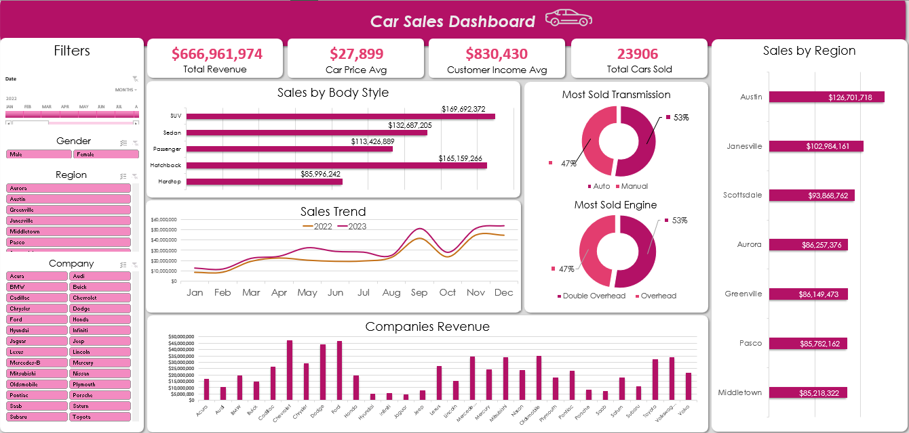

# Multi-Year Car Sales Analytics & Demographic Growth Strategy

## Project Overview

This project analyzes a multi-year car sales dataset to evaluate revenue trends, regional performance, and demographic preferences. Built entirely within **Microsoft Excel**, the project covers end-to-end data processing—from raw data cleaning to an interactive executive dashboard.

---

## Business Requirements

- **Revenue Tracking:** Monitor core KPIs including Total Revenue, Average Vehicle Price, and Total Units Sold.
- **Demographic Insights:** Assess buyer gender distribution and purchasing power.
- **Market & Temporal Trends:** Analyze geographic performance and identify seasonal or weekday vs weekend sales patterns.

---

## Data Cleaning & Feature Engineering

- **Deduplication:** Identified and removed duplicate transaction records based on unique keys (`Car_id`) to prevent inflated sales and revenue figures.
- **Data Standardization:** Cleaned text fields (`Company`, `Dealer_Name`, `Region`) by trimming trailing spaces and applying proper capitalization, while standardizing formatting for Dates, Currency, and Integers.
- **Imputation & Outlier Flagging:** Filled missing values using distribution-based statistical methods (Mean/Median). Created explicit binary flags (`Is_Income Outlier`, `Is_price outlier`) to isolate extreme values without deleting valid purchase logs.
- **Feature Engineering:** Extracted `Day Name` and engineered `Day_Type` (Weekday vs Weekend) from purchase dates to evaluate daily sales velocity and buyer activity patterns.

---

## Dashboard Architecture

The dashboard is structured into a logical 3-tier layout using Pivot Tables and Slicers:

- **Header Tier (Executive KPIs):** Total Revenue, Avg Car Price, Avg Customer Income, and Total Cars Sold.
- **Middle Tier (Trends & Distributions):** Features a multi-line Sales Trend (2022 vs 2023) and bar charts ranking top-performing Body Styles and Companies.
- **Bottom/Side Tier (Demographics & Geography):** Details regional sales leadership and mechanical preferences (Engine & Transmission types) via donut and horizontal bar charts. Includes dynamic slicers for Date, Gender, Region, and Company.

---

## Dashboard Preview

---

## Key Insights & Recommended Actions

### 1. SUVs and Hatchbacks Accounted for Over Half of Units Sold and Revenue

**Key Finding**

SUVs and Hatchbacks generated **$334.9M (50.2% of total revenue)** across **12,502 units (52.3% of total sales)**. Their combined average selling price (**$26.8K**) was below the overall average (**$27.9K**), showing that their high revenue was mainly due to higher sales volume.

**Recommended Actions**

Prioritize these categories in vehicle-mix planning and demand monitoring, given their large share of total units sold and revenue.

### 2. Regional Revenue Differences Were Mainly Linked to Sales Volume

**Key Finding**

Austin generated the highest regional revenue at **$126.7M** from **4,550 units**, while Middletown recorded the lowest at **$85.2M** from **3,064 units**. Despite this gap, both regions had similar average selling prices and customer incomes, suggesting that differences in sales volume largely explain the revenue gap.

**Recommended Actions**

Investigate differences in local demand and dealership sales activity in lower-volume regions before making regional marketing or vehicle-allocation decisions.

### 3. Sales Growth & Temporal Demand Patterns

**Key Findings**

- **Year-over-Year Growth:** Units sold increased by **24.6%** from 2022 to 2023, while revenue grew by **23.6%**. Average selling price declined slightly, showing that sales growth came mainly from an increase in units sold.

- **Recurring Monthly Peaks:** September, November, and December consistently recorded higher sales, with December having the highest monthly unit sales in both years.

- **Weekday vs. Weekend Activity:** Although weekdays accounted for more total transactions, weekends recorded **31% more average daily transactions**, showing higher daily sales activity during weekends.

**Recommended Actions**

Align dealership staffing and sales coverage with higher weekend activity, and plan sales campaigns and operational resources ahead of recurring monthly peaks. Monitor unit growth alongside revenue to track changes in sales volume and average selling prices.

---

## About the Author

**Youssef Hazem Youssef**

Junior Data Analyst | Software Engineering Graduate

- **LinkedIn:** [View LinkedIn Profile](https://www.linkedin.com/in/youssef-hazem-youssef/)
- **Email:** youssef2598@gmail.com
