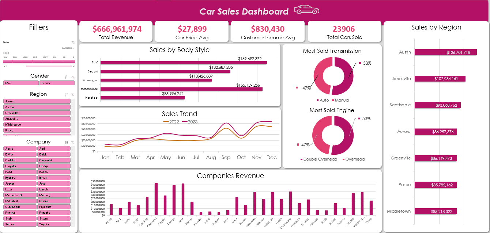

# Multi-Year Car Sales Analytics & Demographic Growth Strategy

## Project Overview

This project analyzes a multi-year car sales dataset to evaluate revenue trends, regional performance, and demographic preferences. Built entirely within **Microsoft Excel**, the project covers end-to-end data processing—from raw data cleaning to an interactive executive dashboard.

---

## Business Requirements

- **Revenue Tracking:** Monitor core KPIs including Total Revenue, Average Vehicle Price, and Total Units Sold.
- **Demographic Insights:** Assess buyer gender distribution and purchasing power.
- **Market & Temporal Trends:** Analyze geographic performance and identify seasonal or weekday vs weekend sales patterns.

---

## Data Cleaning & Feature Engineering

- **Deduplication:** Identified and removed duplicate transaction records based on unique keys (`Car_id`) to prevent inflated sales and revenue figures.
- **Data Standardization:** Cleaned text fields (`Company`, `Dealer_Name`, `Region`) by trimming trailing spaces and applying proper capitalization, while standardizing formatting for Dates, Currency, and Integers.
- **Imputation & Outlier Flagging:** Filled missing values using distribution-based statistical methods (Mean/Median). Created explicit binary flags (`Is_Income Outlier`, `Is_price outlier`) to isolate extreme values without deleting valid purchase logs.
- **Feature Engineering:** Extracted `Day Name` and engineered `Day_Type` (Weekday vs Weekend) from purchase dates to evaluate daily sales velocity and buyer activity patterns.

---

## Dashboard Architecture

The dashboard is structured into a logical 3-tier layout using Pivot Tables and Slicers:

- **Header Tier (Executive KPIs):** Total Revenue, Avg Car Price, Avg Customer Income, and Total Cars Sold.
- **Middle Tier (Trends & Distributions):** Features a multi-line Sales Trend (2022 vs 2023) and bar charts ranking top-performing Body Styles and Companies.
- **Bottom/Side Tier (Demographics & Geography):** Details regional sales leadership and mechanical preferences (Engine & Transmission types) via donut and horizontal bar charts. Includes dynamic slicers for Date, Gender, Region, and Company.

---

## Dashboard Preview

---

## Key Insights & Strategic Recommendations

### 1. Customer Demographics

- **Key Finding:** Male buyers dominate sales volume (79% of transactions) with a higher average income ($849k) compared to female buyers ($758k). My analysis reveals that female buyers mirror overall trends, preferring SUVs and Hatchbacks over all other body styles.
- **Recommended Actions:** Launch targeted marketing campaigns focusing on SUVs and Hatchbacks for female buyers, particularly in high-income regions like Austin, to capture untapped market share.

### 2. Vehicle Body Style Dominance

- **Key Finding:** SUVs ($170M) and Hatchbacks ($165M) remain the core revenue drivers, collectively generating over 50% of total revenue.
- **Recommended Actions:** Prioritize inventory allocation for SUVs and Hatchbacks, while running promotional bundles to clear slower-moving stock like Hardtops ($86M).

### 3. Regional Performance & Market Dynamics

- **Key Finding:** Austin ($127M) and Janesville ($103M) lead overall revenue. Deeper income analysis reveals that male purchasing power in low-performing Middletown ($85M) is comparable to top-tier Austin, indicating that revenue gaps are driven by market engagement rather than customer affordability.
- **Recommended Actions:** Capitalize on proven demand in Austin and Janesville with higher stock allocation, while restructuring marketing and sales execution in Middletown to convert its high-income base into active buyers.

### 4. Sales Velocity & Temporal Trends

- **Key Finding:** Weekdays account for ~65% of total sales transactions. Monthly revenue spikes significantly during seasonal peaks, reaching an all-time high of $51M each in September and November.
- **Recommended Actions:** Align dealership staffing with peak weekday traffic, and build up vehicle inventory prior to the September–November surge to prevent stockouts during peak demand.
